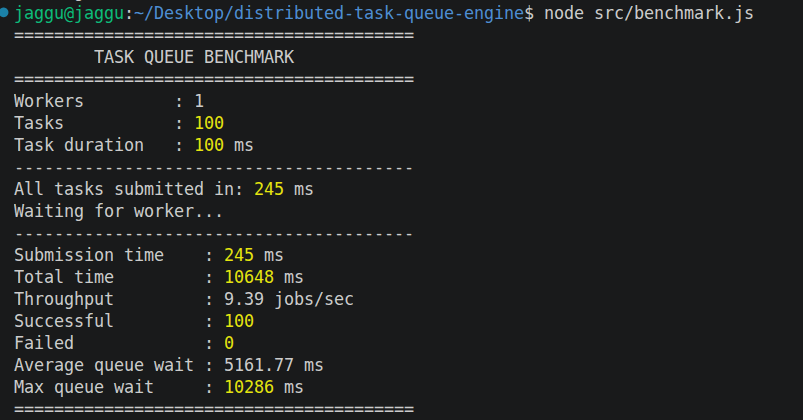

# Distributed Background Task Queue Engine

A background task queue system built from scratch using **Node.js, Redis, Express, and Docker**.

The purpose of this project is to understand how distributed background job systems work internally and gradually implement features commonly found in production-grade systems such as **BullMQ, Celery, and other task-processing systems**.

---

## Architecture

```text
                         ┌──────────────┐
                         │    Client    │
                         └──────┬───────┘
                                │
                                │ POST /tasks
                                ▼
                         ┌──────────────┐
                         │ API Server   │
                         │  (Producer)  │
                         └──────┬───────┘
                                │
                                │ RPUSH
                                ▼
                         ┌──────────────┐
                         │    Redis     │
                         │    Queue     │
                         └──────┬───────┘
                                │
                                │ BLPOP
                                ▼
                         ┌──────────────┐
                         │   Worker     │
                         └──────┬───────┘
                                │
                                ▼
                         ┌──────────────┐
                         │ Task Handler │
                         └──────────────┘
```

Redis currently has two responsibilities:

1. **Queue storage** — stores tasks waiting to be processed.
2. **Task state storage** — stores the current state and metadata of each task.

---

# Current Features

* Producer API
* Redis-backed task queue
* Background worker
* Blocking queue consumption using `BLPOP`
* FIFO queue using `RPUSH` + `BLPOP`
* Task status tracking
* Task creation timestamps
* Task start timestamps
* Task completion timestamps
* Failed task status
* Multiple simulated task types
* Benchmark task
* Load/benchmark runner
* Single-worker performance baseline
* Redis running through Docker

---

# Task Lifecycle

A task currently follows this lifecycle:

```text
                 ┌─────────┐
                 │  QUEUED │
                 └────┬────┘
                      │
                      ▼
                ┌────────────┐
                │ PROCESSING │
                └──────┬─────┘
                       │
                       ▼
                ┌────────────┐
                │ COMPLETED  │
                └────────────┘
```

If execution fails:

```text
                 ┌─────────┐
                 │  QUEUED │
                 └────┬────┘
                      │
                      ▼
                ┌────────────┐
                │ PROCESSING │
                └──────┬─────┘
                       │
                       ▼
                  ┌────────┐
                  │ FAILED │
                  └────────┘
```

Retry functionality will be implemented in a later phase.

---

# Redis Data Model

The main queue is:

```text
task:queue
```

Individual task information is stored using:

```text
task:<task-id>
```

For example:

```text
task:queue

task:aec83502-c200-4b80-924e-40d645cc2474
```

Conceptually:

```text
Redis
│
├── task:queue
│     ├── Task A
│     ├── Task B
│     └── Task C
│
├── task:A
│     └── Task metadata + status
│
├── task:B
│     └── Task metadata + status
│
└── task:C
      └── Task metadata + status
```

The queue and task state are intentionally separated.

The queue answers:

> **What needs to be processed?**

The task record answers:

> **What is happening with this task?**

---

# Project Structure

```text
distributed-task-queue/
│
├── src/
│   ├── server.js
│   ├── worker.js
│   ├── benchmark.js
│   │
│   ├── config/
│   │   └── redis.js
│   │
│   ├── queue/
│   │   └── taskQueue.js
│   │
│   └── tasks/
│       └── taskHandler.js
│
├── docs/
│   └── images/
│       └── single-worker-benchmark.png
│
├── .env
├── .gitignore
├── docker-compose.yml
├── package.json
└── README.md
```

> The `docs/images` directory contains screenshots and other documentation assets.

---

# Tech Stack

| Technology | Purpose                         |
| ---------- | ------------------------------- |
| Node.js    | Application runtime             |
| JavaScript | Implementation language         |
| Express    | HTTP API                        |
| Redis      | Queue and task state            |
| Docker     | Redis environment               |
| Git        | Version control                 |
| GitHub     | Repository and project tracking |

---

# Getting Started

## 1. Clone the repository

```bash
git clone <repository-url>
cd distributed-task-queue
```

## 2. Install dependencies

```bash
npm install
```

## 3. Start Redis

```bash
docker compose up -d
```

Check that Redis is running:

```bash
docker ps
```

You should see the Redis container running.

---

# Environment Variables

Create a `.env` file:

```env
PORT=3000
REDIS_URL=redis://localhost:6379
```

The `.env` file should not be committed to GitHub.

It is included in `.gitignore`.

---

# Running the Application

The project currently has two main processes:

```text
API Server
    │
    ▼
Redis
    ▲
    │
Worker
```

## Start the API server

Open one terminal:

```bash
npm run dev
```

The API will run on:

```text
http://localhost:3000
```

---

## Start the worker

Open another terminal:

```bash
npm run worker
```

The worker connects to Redis and waits for tasks.

You should see:

```text
Redis connected
Worker started
Waiting for tasks...
```

---

# Creating a Task

Send a task to the API:

```bash
curl -X POST http://localhost:3000/tasks \
  -H "Content-Type: application/json" \
  -d '{
    "type": "benchmark-task",
    "payload": {
      "duration": 5000
    }
  }'
```

The API returns a task ID:

```json
{
  "message": "Task added to queue",
  "taskId": "aec83502-c200-4b80-924e-40d645cc2474"
}
```

The API uses HTTP **202 Accepted** because the task has been accepted for background processing but has not necessarily completed yet.

---

# Checking Task Status

Use the task ID returned by the API:

```bash
curl http://localhost:3000/tasks/<task-id>
```

Example:

```bash
curl http://localhost:3000/tasks/aec83502-c200-4b80-924e-40d645cc2474
```

Example response:

```json
{
  "id": "aec83502-c200-4b80-924e-40d645cc2474",
  "type": "benchmark-task",
  "status": "completed",
  "payload": {
    "duration": 5000
  },
  "createdAt": "2026-10-07T17:18:58.676Z",
  "startedAt": "2026-10-07T17:18:58.679Z",
  "completedAt": "2026-10-07T17:19:03.683Z"
}
```

The timestamps allow us to measure:

```text
Queue wait time
        +
Task execution time
        =
Total task lifetime
```

---

# Supported Task Types

The current implementation contains simulated task handlers for:

### Send Email

```text
send-email
```

Simulates sending an email.

### Generate Report

```text
generate-report
```

Simulates report generation.

### Resize Image

```text
resize-image
```

Simulates image processing.

### Generate PDF

```text
generate-pdf
```

Simulates PDF generation.

### Benchmark Task

```text
benchmark-task
```

Used for controlled performance experiments.

For example:

```json
{
  "type": "benchmark-task",
  "payload": {
    "duration": 100
  }
}
```

This simulates a task that takes approximately 100 ms.

---

# How the Worker Consumes Tasks

The worker uses Redis `BLPOP`:

```javascript
const result = await redis.blPop(
    "task:queue",
    0
);
```

The `0` means:

> Wait indefinitely until a task becomes available.

This is different from continuously polling Redis.

Instead of doing:

```text
check
check
check
check
check
```

the worker can remain blocked until Redis has something to return.

The current worker processes one task at a time.

Conceptually:

```text
Worker
  │
  ├── BLPOP
  │
  ▼
Task A
  │
  ├── Execute
  │
  ▼
Completed
  │
  ├── BLPOP
  │
  ▼
Task B
```

---

# Benchmark

A controlled benchmark was created to establish the baseline performance of a **single worker**.

## Baseline Workload

```text
Workers          : 1
Tasks            : 100
Task duration    : 100 ms
```

The theoretical execution time is:

```text
100 tasks × 100 ms
= 10,000 ms
≈ 10 seconds
```

Therefore, with a single worker processing tasks sequentially, the theoretical throughput is approximately:

```text
100 tasks / 10 seconds
≈ 10 jobs/sec
```

## Actual Benchmark

The benchmark was executed locally and produced approximately:

```text
Throughput ≈ 10 jobs/sec
```

### Benchmark Screenshot

The following screenshot shows the actual benchmark output from the development environment:



This result is now the **baseline** for future scalability experiments.

---

# Baseline

```text
┌──────────────────────────────┐
│      SINGLE WORKER BASELINE  │
├──────────────────────────────┤
│ Workers       : 1            │
│ Tasks         : 100          │
│ Duration      : 100 ms       │
│ Throughput    : ≈ 10 jobs/s  │
│ Success       : 100%         │
└──────────────────────────────┘
```

The important purpose of this baseline is not simply the number `10 jobs/sec`.

It gives us a reference point for answering:

> **What happens when we add more workers?**

---

# Scalability Experiments

The next experiment will run the exact same workload using different numbers of workers.

```text
              Tasks
                │
                ▼
             Redis
                │
       ┌────────┼────────┐
       │        │        │
       ▼        ▼        ▼
   Worker 1  Worker 2  Worker 3
```

We will compare:

```text
1 Worker
2 Workers
4 Workers
8 Workers
```

The expected theoretical behavior for 100 ms tasks is approximately:

```text
Workers       Theoretical throughput

1             ~10 jobs/sec
2             ~20 jobs/sec
4             ~40 jobs/sec
8             ~80 jobs/sec
```

Real results will differ because of:

* Redis overhead
* HTTP overhead
* Node.js scheduling
* CPU limitations
* Docker overhead
* status updates
* benchmark polling
* task characteristics

This experiment will help determine where the actual bottleneck appears.

---

# Important Reliability Limitation

The current queue implementation uses:

```text
RPUSH → BLPOP
```

`BLPOP` removes the task from the Redis queue immediately.

Therefore, if a worker crashes after receiving the task but before completing it, the task could potentially be lost.

For example:

```text
Redis Queue
    │
    │ BLPOP
    ▼
Worker
    │
    │ 💥 Worker crashes
    ▼
Task lost
```

This is intentional in the current learning phase.

Reliable acknowledgement, retries, and failure recovery will be implemented later.

---

# Roadmap

## Phase 1 — Basic Queue

* [x] Redis connection
* [x] Producer API
* [x] Redis queue
* [x] Background worker
* [x] Blocking queue consumption
* [x] Task status tracking
* [x] Task timestamps
* [x] Benchmark task
* [x] Benchmark runner
* [x] Single-worker baseline

## Phase 2 — Scaling

* [ ] Multiple workers
* [ ] Worker concurrency
* [ ] Load testing
* [ ] Throughput comparison
* [ ] Queue latency analysis
* [ ] Worker performance analysis

## Phase 3 — Reliability

* [ ] Retry mechanism
* [ ] Retry limits
* [ ] Exponential backoff
* [ ] Jitter
* [ ] Dead Letter Queue
* [ ] Reliable job acknowledgement
* [ ] Graceful worker shutdown

## Phase 4 — Multi-Tenant Queue

* [ ] Tenant identification
* [ ] Per-tenant rate limiting
* [ ] Tenant-specific limits
* [ ] Fair scheduling
* [ ] Tenant metrics

## Phase 5 — Webhooks

* [ ] Webhook delivery
* [ ] HMAC-SHA256 signatures
* [ ] Signature verification
* [ ] Webhook retries
* [ ] Webhook failure handling

## Phase 6 — Observability

* [ ] Structured logging
* [ ] Queue depth metrics
* [ ] Worker metrics
* [ ] Throughput metrics
* [ ] Failure metrics
* [ ] Real-time dashboard
* [ ] Worker monitoring

## Phase 7 — Advanced Experiments

* [ ] BullMQ comparison
* [ ] Redis Streams comparison
* [ ] CPU-bound task benchmark
* [ ] Large-scale load testing
* [ ] Distributed worker deployment
* [ ] Performance optimization

---

# Learning Goals

The project is being built incrementally to understand the underlying concepts instead of simply installing an existing queue library.

The main concepts being explored include:

* Producer/consumer architecture
* Redis data structures
* Blocking operations
* FIFO queues
* Background processing
* Job state management
* Worker concurrency
* Queue latency
* Throughput
* Retries
* Exponential backoff
* Dead Letter Queues
* Rate limiting
* Multi-tenant systems
* Distributed workers
* Webhook security
* HMAC signatures
* Observability
* Scalability
* Failure handling

---

# Current Status

**Phase 1 — Basic Queue: COMPLETE**

The current system can:

```text
Client
  │
  │ POST /tasks
  ▼
API Server
  │
  │ RPUSH
  ▼
Redis Queue
  │
  │ BLPOP
  ▼
Worker
  │
  ▼
Task Handler
  │
  ▼
Task Status
```

A single-worker benchmark has established a baseline of approximately:

```text
≈ 10 jobs/sec
```

for:

```text
100 tasks
100 ms simulated execution time
1 worker
```

The next major experiment is to increase the number of workers and measure how the system scales.

---

# Project Philosophy

This project is intentionally being developed from the fundamentals upward.

Instead of immediately using:

```text
BullMQ
Celery
RabbitMQ
Kafka
```

the initial queue implementation uses Redis primitives directly.

The goal is to understand:

> **What actually happens inside a task queue?**

Once the fundamental implementation is understood, existing production-grade queue systems can be studied and compared against this implementation.

---

## Author

**Ratan Yadav**

Built as a systems/backend engineering learning project.
